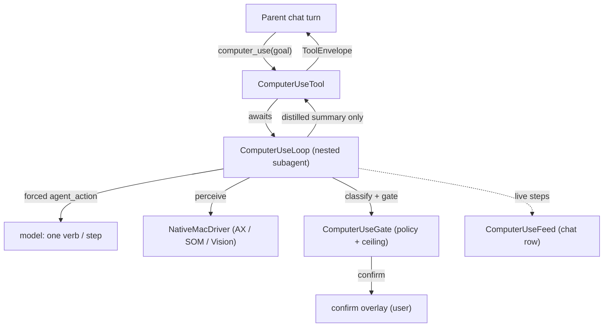

# Computer Use

Drive a real macOS app on the user's behalf to accomplish a natural-language
goal — fill a form, flip a setting, navigate an app, extract on-screen text —
working primarily from the **accessibility tree** and falling back to a
**screenshot** only when an element can't be resolved. Computer Use is
**off by default**, enabled **per agent** (custom agents only), and every
action passes through a **safe-by-default autonomy gate** before it runs.

> **Status: Experimental.** The harness, gate, perception ladder, and the
> local-first cloud-vision boundary are implemented and unit/eval covered. The
> Default agent cannot use it; only custom agents that explicitly enable it.

## Mental model

The parent agent calls one tool — `computer_use(goal:)` — exactly once. That
tool spins up a **nested subagent** (the same `sandbox_reduce` pattern used
elsewhere) that runs a `perceive → decide → gate → act → verify` loop and
returns a single summary. The inner per-step decisions never leak into the
parent chat transcript; they surface only through the live `ComputerUseFeed`
rendered in the chat row.



The model is deliberately kept on a short leash: it only ever proposes **the
next intent** (one `agent_action`). The harness owns every deterministic
decision — which element a mark maps to, which capture tier to use, whether the
gate allows the action, and whether the action actually landed.

## The entry tool — `computer_use`

`ComputerUse/Tool/ComputerUseTool.swift`

| Field | Required | Description |
|-------|----------|-------------|
| `goal` | yes | The complete task in plain language, naming the app when it matters. |
| `app` | no | The app to work in, by name or bundle id. Set it whenever the task names or implies an app. |
| `max_steps` | no | Safety cap on perceive→act cycles. Default `24`, clamped to `[1, 100]`. |

- **Where a run starts.** `ComputerUseLoop.settleTarget` fixes the target
  before anything is perceived, and before the shield is drawn. With `app`,
  the app is opened in the background (it does not take the front) after the
  same gate as an `open` action clears it. A rejected or declined open ends the
  run without acting. Without `app`, the candidate is the frontmost app, or
  the app the user was on before switching to Osaurus. The user is asked
  "Take over <app>?" on an approval card. Saying no ends the run as `declined`
  (tool outcome `declined`, envelope `userDenied`) with nothing perceived or
  clicked. When no card can be shown, or there is no candidate app, the run
  ends `gaveUp` and tells the caller to name the app in `app`. The answer is
  recorded in `ComputerUseRunMetrics.takeoverApproved`. It is not counted with
  per-action confirms.

- **Gating.** Registered as a global built-in so the runtime can execute it and
  ChatView can intercept its feed, but `SystemPromptComposer` strips it
  authoritatively unless the agent set `computerUseEnabled` (custom agents
  only; the Default agent cannot enable it).
- **Runtime authorization (`#2258`).** `ComputerUseKind.resolveModel` re-checks
  the owning agent on every invocation and refuses with a **stage-specific**
  message: Default agent → "switch to a custom agent"; unknown agent; Tools off
  → "turn Tools on"; flag off → "enable it under Agents → the agent → Abilities → Subagents → Computer Use".
  The agent comes from `SubagentScope.current()`, which falls back to the
  Default agent when `ChatExecutionContext.currentAgentId` is unbound — so a
  surface that wants Computer Use must bind the custom agent id (the chat turn,
  `AgentDelegationDispatcher`, `AgentToolLoop`, and the Claude Code bridge
  grant do; a bare `/v1` tool execution with no agent binding is refused).
- **Readiness.** The agent editor's Computer Use card reports
  `systemPermissionMissing` (Unavailable) when Accessibility is not granted, so
  "Active" is only shown when the first call could actually start.
- **Where the Orchestrator stands.** The built-in main chat never gets
  `computer_use`, and an ephemeral spawned worker strips it too. The two paths
  to drive apps are chatting with the custom agent directly, or adding that
  agent to Settings → Agents → Delegation → **Allowed subagents** so the
  Orchestrator can delegate to it (delegated runs keep the agent's full tool surface).
- **Permissions.** Conforms to `PermissionedTool` and requires **Accessibility**
  (`SystemPermission.accessibility`). `ToolRegistry.runPermissionGate` preflights
  the permission before `execute` runs, failing cleanly (`kind: .unavailable`)
  when it's missing.
- **No per-call approval card.** The policy is `.auto`: the **per-action gate**
  (confirm overlay) is the real consent surface, so a per-call approval card
  isn't stacked on top.
- **No registry timeout.** Like `shell_run`, the loop drives a real app over
  many model turns and has no usable wall-clock budget, so it opts out of the
  registry's 120s race (`bypassRegistryTimeout`) and relies on its own
  `RunLimits` plus the user's stop control.
- **Run scope.** The tool resolves the session/agent/model and builds the gate
  and the vision posture from a **single main-actor snapshot**, so a mid-run
  settings edit can't change the rules under a running loop.

On completion it emits one coarse telemetry event and returns a `ToolEnvelope`:
`success(summary)` for `done`, `userDenied` for `interrupted`, and
`executionError` (non-retryable) for `give_up` / dead-end / step-cap / failure.

## The loop — `ComputerUseLoop`

`ComputerUse/Loop/ComputerUseLoop.swift`

Pure orchestration over the injected `MacDriver` / `ComputerUseGating` / confirm
surface — no UI and no registry coupling, so it's fully testable with
`MockMacDriver`.

Each iteration starts with the model's **decision** over the latest `AgentView`,
then runs only the phases the chosen verb needs:

1. **Perceive** — the focused app is captured as an `AgentView`: a numbered list
   of actionable elements (each with a `mark`). For a model whose frames reach
   it without asking, a screenshot with the same mark numbers drawn on it comes
   with every view (see [Pixels by default](#pixels-by-default)). The view marks
   elements that changed since the last step with `*`.
   An initial perceive runs before the loop; afterward perception refreshes
   inside the verbs that need it (`observe`, and the verify after a mutation).
2. **Decide** — the model is pinned to the `agent_action` tool with a forced
   `tool_choice` and a strict JSON schema (constrained verb enum). The arguments
   are coerced + validated by `SchemaValidator`; a malformed shape is fed back as
   a `tool` result for a bounded re-ask.
3. **Gate** — for `open` and element-addressed verbs the action's effect is
   classified (see [Autonomy model](#autonomy-model)) and evaluated against the
   policy: `allow` (run), `confirm` (pause for the user), or `deny` (refuse, with
   a reason fed back to the model). Pure reads (`observe` / `find` / `wait`) skip
   the gate.
4. **Act** — the resolved action is dispatched through the driver.
5. **Verify** — after an element-addressed mutation the loop re-perceives and
   reports the delta so the model can confirm the action landed before moving on.

### Run limits (`RunLimits`)

| Knob | Default | Meaning |
|------|---------|---------|
| `maxSteps` | 24 | Hard cap on productive perceive→act cycles (overridable via `max_steps`). |
| `maxConsecutiveInvalid` | 3 | Malformed `agent_action` re-ask budget. |
| `maxConsecutiveReobserve` | 2 | Re-observe attempts for the same target before it's a dead end. |
| `maxConsecutiveDeadEnd` | 3 | Consecutive dead ends before the run terminates. |
| `maxRepeatedActions` | 4 | Identical actions in a row before the run is treated as stalled. |
| `maxInferenceRetries` | 2 | Retries for a failed inference call before the step errors. |
| `modelStepTimeoutSeconds` | 90 | Per-step budget for the model's `agent_action` decision. |
| `wallClockSeconds` | 20 s × `maxSteps`, at least 300 (480 at the default 24 steps) | Wall-clock budget for the run's own work. It grows with the step cap because a local vision model spends 7–15 s per step, so a long `max_steps` run isn't cut off by a fixed clock. Time the user spends on a confirm card or cloud-vision consent prompt is credited back, so a slow approval never becomes "Reached the time limit". |
| `requireVerifiedChangeForDone` | `true` | A `done` after at least one acting step is only accepted once a verify (or a later `observe` / `wait`) saw the view change. The model gets one challenge to look again; a second unproven `done` ends the run as `gaveUp`. Scripted evals that only exercise gate/parse contracts may turn it off. |
| `contextPositions` | the model's resolved window | History-window ceiling. Every step's history is trimmed to it, and the runtime checks the tokenized request against it (`AdmissionPositionLimit`), so RAM admission can price exactly this number. Set by `ComputerUseKind`; see below. |

### Memory admission

A local Computer Use run goes through the same RAM-safety admission as other
local subagents (Settings → Agents → Delegation → Check Memory Before
Delegating). `ComputerUseKind` adopts `SubagentContextAdmission`:

- It prices `contextPositions`, which starts at the model's resolved context
  window (the bundle's window capped by the user's context-length setting).
  It never prices an unbounded model-wide estimate.
- When even that one run would not fit, admission fits the window to the
  memory left, never below `ComputerUseLoop.minimumStepPositions`. That
  minimum covers one step: the system prompt and goal, the action schema,
  one screenshot at the image estimator's per-image ceiling (image models
  only; at most one screenshot is ever in context), one view listing at the
  delegated per-turn tool-result allowance, and one response.
- A fitted run keeps fewer earlier steps in history. It does not lose any
  step, output, or time limit.
- If the minimum does not fit either, the run is refused before any model
  memory is allocated, and the refusal shows the numbers it used.

### Outcomes (`RunOutcome`)

`done(summary)` · `gaveUp(reason)` · `stepCapReached` · `deadEnd(reason)` ·
`interrupted` · `declined(app)` · `failed(reason)`.

### What the feed records

The feed (live in chat, and stored with the run) names what each action
touched, not how the model addressed it. Propose, act and gate events
(Blocked, Confirm, Approved, Declined) use `AgentAction.auditLabel`. It gives
the resolved element by role and label, then the app: `Click button "Send" in
Mail` rather than `Click mark 136`. Propose events resolve the mark against
the current view. Act and gate events use the element the action actually
resolved to, including a screenshot point's hit-tested element. A target that
didn't resolve keeps the model's address (`mark 4`, `point (120, 80)`).
Typed text is recorded only as a length (`Type 22 characters into textfield
"To" in Mail`). The text itself is shown on the confirm card, where
`ActionPreview` still carries it, and never in a feed title.

### Honest verify results

Synthesized macOS input is fire-and-forget: `SLEventPostToPid` /
`CGEvent.postToPid` return before the target processes the event and carry no
delivery acknowledgement, so a driver "success" only means *the input was
posted*. The verify step therefore reports three distinct states to the model:

- **`Action succeeded.`** — the driver returned success **and** the re-perceive
  saw the view change (`metrics.verifyChanged`). The result names the changes
  (`AgentView.changes`, at most six lines): `[3] statictext "State": "inbox" →
  "archived"`, `[7] button "Undo" appeared`, `button "Archive" disappeared`.
  Secure fields are never diffed. Before this, the model read only "The view
  changed." and Qwen3-VL-8B repeated a click that had already archived the email
  until the repeat guard stopped it. The lines sit before the listing, so they
  stay in history after the listing is compacted.
- **`Input was posted, but no change was observed …`** — the driver returned
  success but nothing changed (`metrics.unverifiedActs`). The model is told to
  `wait` / `observe` before retrying and never to report `done` on it alone.
- **`Action failed: …`** — the driver itself failed (stale/removed element,
  route error).

Two more pre-act guards keep the model out of a void: the loop asks the driver
whether `currentPid` is still alive before posting input (a quit or relaunched
app is reported and `currentPid` cleared instead of "succeeding" into a dead
pid), and `open` reports **not ready** — rather than "Opened X" — when the
readiness poll exhausted its budget *and* the follow-up capture is empty.

The liveness check runs again in `performAct`, after the gate, because the
target can quit while its approval card is up. A dead target also skips the
stale-ref coordinate retry (its old frame now belongs to whatever window is
underneath), `BackgroundDriver` fails input for a pid with no WindowServer
connection instead of reporting it delivered, and a capture scoped to an app
or window returns nothing rather than widening to the main display. Live
finding: Calculator quit during a card, and after Approve the run retried the
click at the old frame and handed the model a full-screen capture showing the
user's Music window.

### Confirm cards need a surface

The confirm/consent card is rendered by `ComputerUseConfirmOverlay`, mounted in
`ChatView`. The overlay registers itself with `ComputerUsePromptQueue`
(`presenterCount`); when no overlay is mounted (chat window closed, headless
dispatch) a gated action fails fast — the run ends `gaveUp` with the reason
"no chat window is open to show the approval card" — instead of parking on a
card nobody can answer until the wall clock.

### The action envelope — `AgentAction`

`ComputerUse/Model/AgentAction.swift`. The model fills **one** `agent_action`
per step (never the raw driver primitives). Elements are addressed by the
`mark` number from the current view, a natural-language `target.describe`
fallback that the `TargetResolver` matches, or a `target.point` in the latest
screenshot.

| Verb | Baseline effect | Needs |
|------|-----------------|-------|
| `observe` | read | — (fresh look) |
| `find` | read | `query` and/or `roles` |
| `wait` | read | — (optional `seconds`, capped) |
| `screenshot` | read | — (captures and attaches a frame; needs an image-capable model and Screen Recording) |
| `zoom` | read | `region` `{x, y, width, height}` in the latest screenshot, in the model's [grounding frame](#grounding-profiles) |
| `click` | navigate | `target` |
| `double_click` | navigate | `target` |
| `right_click` | navigate | `target` |
| `hover` | navigate | `target` (moves the pointer only) |
| `scroll` | navigate | `direction` |
| `select` | navigate | `target` (popup, menu button, or combo box) + `option` title |
| `open` | navigate | `app` |
| `type` | edit | `text` (+ optional `target`, `replace`) |
| `set_value` | edit | `target` + `text` |
| `clear` | edit | `target` |
| `drag` | edit | `target` + `to` |
| `press_key` | edit | `key` (+ optional `modifiers`, `repeat` 1–20) |
| `batch` | read (each step is gated on its own) | `actions`: 1–8 acting steps |
| `done` | read | `reason` (success summary) |
| `give_up` | read | `reason` (why not) |

The verb sets a **baseline** effect; the classifier can only ever escalate it
(never lower it).

**Screenshot points.** `target.point` is `{x, y}` or `[x, y]` (the schema
declares both; the array is how Qwen-VL grounding writes it) in the last frame the model
was shown (origin top-left), written in the model's
[grounding frame](#grounding-profiles): pixels of that frame, or 0–1000 or 0–1
of its width and height. A model with no profile can't use points or `zoom`.
The loop converts the point to frame pixels, maps it to screen points through
the frame's screen region (`CUImage.region`), then hit-tests the
captured AX elements and takes the smallest one containing the point. The gate
classifies the action by that element, so a point on a Delete button confirms
as a delete whatever `describe` says. A point on no known element leaves the
classifier with no label, which escalates the click to an edit (the ambiguous
click rule). `set_value`, `clear`, and `select` need an element under the
point. After a `zoom`, points refer to the close-up until the next screenshot.
A plain `click` whose point hits a control that presses (a button, checkbox,
radio button, menu item, link, or popup/menu button that offers `AXPress`) goes
through the element: `AXPress`, then a window-bound click. Calculator, a SwiftUI
app, drops a click posted to its pid while it is in the background, but `AXPress`
on the same button lands (`CalculatorBackgroundInputProbe`,
`OSAURUS_CU_LIVE_CALCULATOR=1`). Double and right clicks, and points on
anything else, are posted at the point.

**`zoom`** crops the region from a fresh full-resolution window capture (at
most 1568 pixels on the long edge) and attaches it. **`hover`** posts a
window-bound per-pid `mouseMoved`, so the user's pointer does not move.
**`select`** sets a combo box's value and reads it back. For other controls it
opens the control (`AXPress` or `AXShowMenu`), picks the one enabled menu item
whose title matches (exact, then unique prefix, then unique substring), and,
for a popup that shows a value, reads it back. A miss lists the real options.

**`batch`** runs up to 8 acting steps (click, double_click, right_click, hover,
select, drag, type, set_value, clear, press_key, scroll) in order against the
view the model saw. Each step passes the gate on its own. The batch stops at
the first step that can't be resolved, is declined, or fails, and after any
step that needed approval, so the model sees an approved action's result
before anything else runs. One verify capture follows the last step that ran.
Single-action calls stay valid, so small local models can ignore `batch`.

## Perception ladder

`ComputerUse/Driver/Mac/CaptureMode.swift`, `ComputerUse/Perception/CaptureRouter.swift`

Capture climbs a three-rung ladder, escalating only when the accessibility tree
can't carry the step:

| Tier | What it captures | Permission |
|------|------------------|------------|
| `ax` | Accessibility tree only, no pixels. Fastest. | Accessibility |
| `som` | Set-of-mark: AX tree **+** screenshot. The loop draws each element's `mark` number on the frame (`FramePreparer`), so the image and the element list use the same numbers and internal element ids never reach the image. | + Screen Recording |
| `vision` | The same screenshot without marks, for when the marks get in the way of reading the screen (the AX tree is still gathered for element ids). | + Screen Recording |

Both pixel tiers capture the window at full backing resolution, up to a 1568 px
long edge, honor `interactiveOnly`, and wait for an Electron/Chromium tree the
same way `ax` does.

The loop captures with `interactiveOnly`: actionable elements, plus the first 24
passive elements that carry a value (`ElementFilter.capturePassiveValueLimit`),
which count toward the element cap. Those are the state the controls change.
Without them, Calculator's display was not in the view, so a digit press read as
"no visible change" and the result could not be read back.

`CaptureRouter` decides the next tier. In production it escalates when a target
can't be resolved (`targetUnresolved`) or the AX tree comes back empty
(`axEmpty` — Electron / custom-drawn UI); `nextTier` advances strictly by tier
and treats the reason as informational. The model's `screenshot` verb asks for
pixels directly (`pixelsRequested`). **Without Screen Recording the router stays
on `ax`** — there is nothing to escalate to, so the loop must work with the AX
tree or `give_up`.

### Pixels by default

`ComputerUse/Loop/ComputerUseLoop.swift` (`restingTier`), `ComputerUse/Perception/FrameBudget.swift`, `ComputerUse/Perception/FramePreparer.swift`

A run rests at `som` instead of `ax` when its frames reach the model without
asking (`VisionContext.attachesPixelsByDefault`): the model takes images,
Screen Recording is on, and the model is on-device or the user already allowed
cloud vision. That run sends a marked screenshot with the first view and with
every verify, and drops back to `som` (not `ax`) once a target resolves. A
remote model without consent rests at `ax`, so default perception never raises
the cloud-vision prompt; the prompt still appears when the run escalates or the
model calls `screenshot`.

Before a frame is attached, `FramePreparer` fits it to the run's `FrameBudget`
(it only ever shrinks) and draws the marks:

- **`FrameBudget.standard`** — at most 1568 px on the long edge and about
  1.15 MP, the size frontier vision models take without resizing again.
- **Local bundles** narrow it from `preprocessor_config.json`
  (`FrameBudget.resolve(modelDirectory:)`, read once at run start into
  `VisionContext.frameBudget`). A processor that declares `merge_size` resizes
  on a `patch_size × merge_size` grid with a pixel cap in `max_pixels` or
  `size.longest_edge` (both a pixel count, the way the runtime reads them), so
  both sides are snapped down to that grid and the cap applies when it is
  smaller. Any other processor's `size.longest_edge` is an edge length. A
  bundle without the file keeps `standard`.

Fitting to the model's own grid means the runtime doesn't resize the frame
again, so the image a `target.point` is read against is the image the model saw.
The frame keeps its `region`, and `ScreenshotPointing` maps points through the
fitted size. Marks are drawn only on `som` frames, for the elements whose
boxes fall inside the frame. Each one is a red outline with the mark number in
a tag at its top-left corner. On the cloud path the marks are drawn **after**
`FrameScrubber` (`ScrubbedFrame.withMarks`): a mark is a harness-generated
number and box, so nothing from the screen goes back over a masked region, and
`.allText` masking doesn't hide the numbers.

### Grounding profiles

`ComputerUse/Perception/GroundingProfile.swift`, `GroundingCalibration.swift`, `GroundingCalibrationStore.swift`

Models write coordinates in different frames: pixels of the image they were
shown, 0–1000 of its width and height, or 0–1. Reading a 0–1000 answer as
pixels clicks the wrong place, so each run carries a `GroundingProfile`
(`VisionContext.grounding`) next to its `FrameBudget`, and the loop reads
`target.point` and zoom regions through it. The action schema, system prompt,
and image note name the frame in use.

`VisionContext.resolved(for:)` settles the profile once per run, in this order:

1. **Declared** by the bundle's own metadata: `jang_config.json` with
   `{"grounding": {"coordinate_frame": "…"}}` (or
   `capabilities.grounding.coordinate_frame`).
2. **Stated** in `preprocessor_config.json`, `config.json`, or
   `generation_config.json` in the same shape.
3. **Calibrated** once per bundle. When nothing states a frame, the run's first
   act is `GroundingCalibration`: the model sees five synthetic app screens,
   sized to its budget and far from 1000 px on a side, and is asked to click a
   named button. The screens have no element list, so the calibration
   schema offers only `click` with a `target.point`; it and the prompt name
   no convention, so the model answers in its trained frame. Each answer is scored under every frame, and
   the target boxes are placed so no two frames can both hit. A frame is
   adopted only when it alone hits at least two thirds of the screens. The
   outcome is cached in `computer-use-grounding.json` under the cache
   directory, keyed by model id, a hash of the bundle's config and template
   files, and the budget. Any change to those calibrates again. The feed shows
   the check and its result with token/s.
4. **Marks only** when calibration finds no consistent frame (or is
   interrupted). The model addresses elements by `mark` and `describe`;
   `target.point` and `zoom` return a typed refusal instead of a guess.

Hosted models point in pixels of the image they were sent
(`GroundingProfile.providerPixels`). A model whose only grounding is its own
action grammar (its own click syntax rather than `agent_action`) isn't
coerced into this schema; it stays off the Computer Use model catalog.

## Cloud-vision boundary (local-first)

By default perception is **local-only**: the AX tree and any screenshots stay on
the Mac (on-device Vision OCR included). A screenshot may reach a **cloud** model
only through a route that is made *unrepresentable* without consent **and**
scrubbing:

- **`CloudVisionConsent`** (`ComputerUse/Perception/CloudVisionConsent.swift`) —
  off by default, never inferred. Two grant scopes: persisted opt-in (survives
  relaunch, `UserDefaults` key `ai.osaurus.computeruse.cloudVisionConsent`) and a
  transient this-launch-only grant. Revoke clears both.
- **`FrameScrubber`** (`ComputerUse/Perception/FrameScrubber.swift`) — the only
  producer of a `ScrubbedFrame`. It runs Vision OCR over a frame and redacts it
  in one of two modes:
  - **`.allText` (default for cloud)** — paints opaque boxes over **every**
    recognized text region, so nothing readable leaves the device. This is what
    a consented cloud screenshot uses out of the box.
  - **`.pii`** (opt-in via Settings → Computer & Browser Use → *Mask only detected
    sensitive text*) — masks only regions whose text matched a detector. For
    parity with outbound text filtering, the cloud path runs **both** the
    `RegexEntityDetector` layer built from the **user's configured Privacy
    Filter ruleset** (`honorUserRules: true` — honoring disabled categories,
    presets, and custom rules) **and** the on-device NER model
    (`PrivacyFilterEngine.modelSpans`) for `person` / `address` / `date` /
    `secret`, which have no regex. A region with a model hit is masked whole
    (recall over precision). Detection isn't perfect — OCR or the model can
    miss text — which is why `.allText` is the default.

  Either way it paints opaque boxes before any frame can leave the device. A
  `ScrubReport` (counts only) stays on-device for the feed/telemetry. The mode
  is resolved once per run into `VisionContext.cloudScrubMode` so a mid-run
  settings edit can't change it under a running loop.
- **`CaptureRouter.cloudRoute(...)`** — accepts **only** a `ScrubbedFrame` and
  returns `nil` unless consent is granted and Screen Recording is on. So the
  harness physically cannot reach `.cloudVision` without both a scrubbed frame
  and consent.
- **`VisionAttachment`** (`ComputerUse/Perception/VisionAttachment.swift`) — the
  pure decision helper that turns "we have pixels + this model/consent posture"
  into a `Plan`: `.none`, `.localFrame` (local model — attach as-is), or
  `.needsScrubForCloud` (remote model — scrub then route). The loop attaches at
  most one screenshot to the conversation at a time and reserves image tokens
  against the context budget. When a frame *would* reach a cloud model if only
  consent were granted (`wouldAttachWithConsent`), the loop surfaces a
  **just-in-time consent prompt** once per run (Allow once / Always allow / Not
  now) instead of silently staying AX-only — wiring `grantForSession()` /
  `grantPersistently()` to the user's choice.

A frame is only ever attached to a model request when **the model accepts
images** (`ComputerUseTool.modelAcceptsImages`: local VLM detection / media
capabilities, or the remote router's advertised vision support) and the capture
ran above `ax`: by default for a run that [rests at `som`](#pixels-by-default),
otherwise after an escalation or a `screenshot` / `zoom`.

## Screen context (chat)

Separate from the `computer_use` tool, **Screen context** gives the assistant
ambient awareness of what you're doing *without driving anything*. It's a
**per-agent** option nested under Computer Use (Agents → the agent → Abilities → Subagents →
*Computer Use* → *Share screen context*), **on by default** once an agent has
Computer Use enabled. The effective value is gated by the per-agent
`computerUseEnabled` (`screenContextEnabled && computerUseEnabled`), so an agent
without Computer Use — including the built-in Default agent — never injects screen
context. Settings → Computer & Browser Use → *Screen context* keeps an explainer and a live
preview, but the on/off control lives on each agent.

When enabled, a distilled, text-only snapshot of your screen is **frozen** on the
**first send** of a chat session and reused unchanged for the rest of that
conversation (a new/loaded chat re-freezes on its next send); the capture may be
primed slightly earlier but is **locked** at that first send. The snapshot is
built entirely from the **accessibility tree** — no screenshots — so it can pass
through the text-based Privacy Filter.

### Smart sampling — `ScreenContextDistiller`

`ComputerUse/Perception/ScreenContextDistiller.swift`. Rather than dumping the
AX tree, the distiller samples the highest-signal bits, budgeted small:

- **Working app** — the frontmost app, or, when Osaurus is itself frontmost at
  send time, the most-recently-active non-Osaurus app. `FrontmostAppTracker`
  records that app from launch (Osaurus excluded by pid / bundle id) so "what
  you were doing" survives the chat stealing focus.
- **Activity gist** — one line, e.g. `In Mail — "Re: Project update"; editing
  text area (draft present)`.
- **Focused field** — role + label + placeholder + current value (the draft).
- **Open windows** — app + title + which is frontmost.
- **On screen** — a ranked, de-duplicated sample of salient labels / values.

`ScreenContextSnapshot.render()` is the single source of truth for the
`[Screen Context]…[/Screen Context]` block — the same text shown in the settings
preview and injected into chat.

### Injection + privacy

The block is prepended to the **latest user message**
(`SystemPromptComposer.injectScreenContextPrefix`, the same seam memory uses),
not the system prompt. That keeps the system prefix byte-stable for KV reuse
**and** routes the snapshot through `RemoteProviderService.applyPrivacyOutbound`
— the Privacy Filter only scans the latest user turn — so PII is scrubbed before
any cloud send. Local models receive it as-is, matching the rest of the local
path. The settings card previews the live snapshot (with a Refresh) and, when
the Privacy Filter is on and loaded, reports how many spans would be masked.

## Autonomy model

The gate decides `allow` / `confirm` / `deny` for every action by combining a
**classified effect** with a **layered policy**.

### Effect classification

`ComputerUse/Policy/EffectClass.swift`, `EffectClassifier.swift`

| Effect | Meaning |
|--------|---------|
| `read` | Pure perception — re-observe, query, narrate. Never mutates. **Always `allow`.** |
| `navigate` | Moves focus / viewport / app without committing: click a link or tab, scroll, switch app. |
| `edit` | Mutates reviewable/undoable state: type, set a value, clear a field. |
| `consequential` | Commits something hard to undo or crossing a trust boundary: send, submit, delete, purchase, share with recipients. |

The classifier starts from the verb's baseline and **escalates** using the
resolved role + app context. Its signal string includes the element's `label`,
`roleDescription`, and (for non-text-input roles) `value` — so an icon-only or
value-titled control is still classified — plus the model's `describe`/`note`.
Escalation rules:

- **Consequential signals** (Send / Delete / Purchase / Submit …) escalate to
  `consequential` on their own.
- **Commit signals** (Save / Done / Apply / OK / Create / Add …) escalate to
  `consequential` when paired with **recipients**, and otherwise to at least
  **`edit`** on their own — so a bare "Save"/"OK" confirms under `balanced`
  instead of silently auto-running as `navigate`.
- **Icon-only / ambiguous controls** — a click on a button-like role with no
  readable label/value/description (or any click with no identifiable target)
  escalates to at least `edit`.
- **Key chords** that submit, delete or end something escalate to
  `consequential`: ⌘Return / ⌘Enter, ⌘Delete / ⌘⌦ (Move to Trash), ⌘Q with
  any other modifiers (quit, ⇧ log out, ⌃ lock screen), and ⌥⌘Esc (Force
  Quit). They confirm under `trusted` too. A `press_key` whose `modifiers`
  hold anything but a modifier name (say `key: "command", modifiers: ["q"]`)
  is rejected back to the model before the gate, so the chord that is
  classified is the chord that is pressed.
- Plus per-app recipe signals.

It can only raise the effect, never lower it.

Independently of the preset/override/ceiling — and of the (often-empty)
allowlist — `ComputerUseGate` applies a **dangerous-app guardrail**: driving a
sensitive app (Terminal & friends, System Settings, Keychain Access, Activity
Monitor, Disk Utility, Script Editor/Automator, password managers, …) always
requires at least a confirm. It can only tighten, and the user can still
approve at the prompt (`AutonomyPolicy.forcedConfirmAppNeedles`).

### Policy stack (strictest-wins)

`ComputerUse/Policy/AutonomyPolicy.swift`

| Preset | navigate | edit | consequential |
|--------|----------|------|---------------|
| `read_only` | allow | **deny** | **deny** |
| `cautious` | confirm | confirm | confirm |
| **`balanced`** (default) | allow | confirm | confirm |
| `trusted` | allow | allow | confirm |
| `autonomous` | allow | allow | allow |

(`read` is always `allow`.) The effective disposition merges **strictest-wins**
across three layers:

1. **Global preset** — the baseline stance for every app.
2. **Per-app override** — keyed by normalized app name; can only make an app
   *stricter*, never looser. To grant an app more autonomy, raise the global
   preset.
3. **Per-agent ceiling** (`AutonomyCeiling`) — a structured hard cap stored on
   the agent (the spec's "SOUL.md ceiling" as settings, not parsed prose). An
   agent can be held stricter than the user's default but never looser.

**Allowlist.** When `AutonomyPolicy.allowlist` is non-empty, **only** those apps
may be driven — checked *first*, before any disposition. The `open` verb is
gated the same way: launching/switching to an app classifies as `navigate` and
runs through `isAppAllowed` + the navigate disposition. So a non-empty allowlist
blocks any app not on it, and a `cautious` preset turns an app launch into a
confirm; under `read_only` / `balanced` / `trusted` / `autonomous`, navigate is
`allow`, so the launch itself runs once the app clears the allowlist.

## App recipes

`ComputerUse/Recipes/AppRecipe.swift`. Per-app refinements carry two things:

1. **Effect signals** — app-specific words that push the classifier toward
   `consequential` (e.g. a browser "Leave site" / "Resend", a dialog
   "Don't Save" / "Discard"). Merged into `EffectClassifier` per app.
2. **Flows** — human-readable ordered hint sequences for common tasks, rendered
   compactly by `AppRecipes.guidanceText(for:)` and injected once per app into
   the loop's system prompt so the model gets the proven sequence (e.g. the
   address-bar flow) instead of rediscovering it.

Shipped seeds: a **universal dialog** recipe (modal sheets escalate everywhere),
**Safari**, and a **Chromium family** recipe (Chrome / Edge / Brave / Arc /
Vivaldi / Opera).

## UI surfaces

- **Settings → Computer & Browser Use** (`Views/Settings/ComputerUseSettingsView.swift`) —
  global preset picker, per-app overrides (the picker is filtered to presets at
  least as strict as the global default, since a looser per-app rule would
  silently no-op), app allowlist, the **Cloud vision** consent toggle (off by
  default) plus a **Mask only detected sensitive text** toggle (off = `.allText`,
  the safest) and copy disclosing the on-device scrub's limits and the Screen
  Recording dependency, the **Screen context** explainer + live preview (the
  on/off control is per-agent — see below), Accessibility / Screen Recording
  permission rows, and an "Enabling Computer Use" explainer.
- **Per-agent** (Agents → the agent → Abilities → Subagents → *Computer Use*) — the
  `computerUseEnabled` toggle, and nested under it the **Share screen context**
  toggle (`screenContextEnabled`, on by default) and the per-agent autonomy
  **ceiling** picker. Custom agents only.
- **Live activity** (`Views/Chat/ComputerUseFeedView.swift`) — the
  `ComputerUseFeed` renders each perceive/decide/gate/act/verify step in the
  chat row; the inner steps never enter the parent transcript.
- **Confirm overlay** — `confirm` dispositions pause the loop and surface an
  `ActionPreview` (structured app / action / target / expandable typed-text
  fields, with an optional "don't ask again for similar actions in this app"
  for the run) through the single-slot `ComputerUsePromptQueue`, which also
  hosts the just-in-time cloud-vision consent card. Every Stop — the feed's
  [Stop], the takeover pill, Esc — interrupts the run (`InterruptToken`), and
  the interrupt withdraws the run's pending cards
  (`ComputerUsePromptQueue.cancelOnInterrupt`), so Stop works even while a
  confirmation is up and ends the run as stopped, not declined. Stop also
  cancels the in-flight model step,
  and the gate re-checks the token after every clear (including a late
  Approve), so no input is posted once Stop is pressed — not the action the
  model was deciding, and not the rest of a batch.

## Telemetry

Three coarse, privacy-clean events form a funnel — **no goal text, no app
names, no agent ids, no per-step detail** in any of them:

| Event | Fired from | Properties |
|-------|-----------|------------|
| `computer_use_attempt` | `ToolRegistry.runPermissionGate` — the one chokepoint every real `computer_use` invocation passes, *before* any refusal | none |
| `computer_use_refused` | The Accessibility gate (registry) and `ComputerUseTool.execute` for every other pre-loop refusal | `stage` ∈ `permission_accessibility` · `agent_auth` · `model_unavailable` · `handoff_denied` · `recursion` · `admission_timeout` · `ram_safety` · `cancelled` · `other` |
| `computer_use_run` | `ComputerUseKind.run`, after the loop | `outcome`, `max_tier`, `steps_bucket` (`0` / `1-3` / `4-9` / `10+`), `confirms_bucket`, `ax_resolvable` (`na` / `low` / `med` / `high`), `verify_pass`, `had_dead_end`, `had_block`, `cloud_vision_used`, `route_used` (`none` / `sky_light` / `per_pid` / `hid_fallback` / `mixed`), `done_without_change` (declared `done` after acting while no view change was ever observed), `unverified_acts_bucket` |

Reading the funnel: `attempt − refused − run` should be ≈ 0. A drop in
`attempt` is demand (the model stopped calling the tool); a rise in `refused`
is a gate (segment by `stage`); a rise in `done_without_change` or a fall in
`verify_pass` is driver/verify reliability. Before this funnel existed only
`computer_use_run` was emitted, so every pre-loop refusal (Default-agent
scope, `#2258` runtime deny, missing Accessibility, handoff/admission/RAM
policy) was invisible and read as "usage dropped".

`ComputerUseKind` tags its own refusals (`refusalStage`: agent auth, model,
handoff); host-level refusals are attributed from **structured envelope
fields** the host sets (`recursion: true`, `admission: timeout`,
`admission: stable_memory_refusal`, `cancelled: true`) — never from message
text — so the stage token is stable across copy edits.

The full-fidelity `ComputerUseRunMetrics` — run-level counters, the highest
capture tier reached (`maxTier`), `unverifiedActs`, `routeCounts`,
`confirmsUnpresentable`, and per-`EffectClass` counts — stays in-process and
feeds the eval harness, which the shipped telemetry intentionally never sends.

## Storage & configuration

| Path / key | Purpose |
|------------|---------|
| `~/.osaurus/config/computer-use.json` | `AutonomyPolicy` (global preset + per-app overrides + allowlist), via `ComputerUsePolicyStore`. |
| `UserDefaults` `ai.osaurus.computeruse.cloudVisionConsent` | Persisted cloud-vision opt-in (default `false`). |
| `UserDefaults` `ai.osaurus.computeruse.cloudVisionPIIOnly` | Cloud screenshot redaction mode: `false` (default) = `.allText` (mask everything), `true` = `.pii` (mask only detected sensitive text). |
| `~/.osaurus/cache/computer-use-grounding.json` | Per-bundle grounding calibration outcomes (`GroundingCalibrationStore`): frame or marks only, hits per frame, date. Safe to delete; the next run calibrates again. |
| `Agent.settings.computerUseEnabled` / `computerUseCeiling` / `screenContextEnabled` | Per-agent enablement + autonomy ceiling + screen-context opt-in (in the agent JSON). `screenContextEnabled` defaults `true` and is gated by `computerUseEnabled`. |

## Testing & evals

- **Unit tests** — `Packages/OsaurusCore/Tests/ComputerUse/` cover the
  perception/vision-attachment decision matrix, the policy gate (including
  `open`-verb gating), recipe guidance, and the system prompt's policy stance.
- **Eval suite** — `Packages/OsaurusEvals/Suites/ComputerUse/` pins the gate
  end-to-end with pure data (no driver, no permissions, no model), so it runs
  CI-safe on every PR. See its [README](../Packages/OsaurusEvals/Suites/ComputerUse/README.md).
- **Loop eval suite** — `Packages/OsaurusEvals/Suites/ComputerUseLoop/` runs
  the real `ComputerUseLoop` against a scripted in-memory driver. Its scripted
  (`scriptedActions`) cases are model-free and pin the reliability contracts
  above — unverified `done` → `gaveUp`, honest unverified-input reporting,
  not-ready `open`, confirm wait credited to the wall clock, fail-fast when no
  confirm surface exists. Both suites are in `make evals-deterministic`
  (`floors.json` pass rate 1.0); that lane sets
  `OSAURUS_EVALS_SCRIPTED_ONLY=1` so the suite's live-model cases skip and no
  model is loaded. Live-model cases run with the model's own vision posture
  (`VisionContext.resolved(for:)`, cloud-vision consent off), so an image
  model gets marked frames by default exactly as in chat. See its
  [README](../Packages/OsaurusEvals/Suites/ComputerUseLoop/README.md).
- **Grounding eval suite** — `Packages/OsaurusEvals/Suites/ComputerUseGrounding/`
  shows a model the calibration screens and scores point-in-box accuracy per
  coordinate frame with decode token/s (`ComputerUseGroundingProbe`). Its
  `scriptedFrame` rows are model-free and in `make evals-deterministic`; the
  live row is the grounding proof for a Computer Use catalog model. See its
  [README](../Packages/OsaurusEvals/Suites/ComputerUseGrounding/README.md).
- **Local web-form proof** — `Packages/OsaurusCore/Tests/ComputerUse/Fixtures/WebForm/`
  plus `ComputerUseEvidencePackTests` prove a deterministic form-fill path
  through the real loop using `MockMacDriver`; evidence is generated by
  `make computer-use-evidence`.

```bash
OSAURUS_DISABLE_KEYCHAIN_FOR_TESTS=1 OSAURUS_TEST_ROOT=/tmp/osaurus-test make test
```

### Local model proof

A bundle is listed under Local Models → Computer Use (`ComputerUseModelCatalog`)
only after it scores at least 12 of the 15 live rows of the loop suite with no
click on a `failIfClicked` control, passes the grounding suite, and runs a
Computer Use turn in the app. Each row records decode token/s and peak
memory. Sampling comes from the bundle's `generation_config.json`.

| Bundle | Loop, live rows | Grounding | Decode | Peak | Listed |
|---|---|---|---|---|---|
| `mlx-community/Qwen3-VL-8B-Instruct-4bit` | 13/15, then 12/15 with one forbidden click (scripted 23/23) | normalized 0–1000, 5/5 | 32.8 / 33.1 tok/s | 11.1 / 11.2 GB | yes, under review |
| `mlx-community/Qwen3-VL-4B-Instruct-4bit` | 10/15, one forbidden click | normalized 0–1000, 5/5 | 44.8 tok/s | 8.2 GB | no |

The 8B has two full runs. Both fail `find-among-duplicates` (it clicks
Checkout again after the result listed `"browsing" → "ordered"`) and
`read-and-report` (it keeps observing a view that shows the ticket number).
The second run also fails `impossible-give-up`: it flails to the step cap and
clicks the forbidden Send. That case runs under the Autonomous preset, so
nothing asked first; Balanced, the default, confirms a Send. Rerun alone three
times, the same case passed twice and failed once at the step cap, with no
Send click. The forbidden click misses the rule above, so the 8B's listing
is under review. The 4B fails twice on the `agent_action` shape, twice by
repeating a click that changed nothing, and clicks the forbidden Send in
`impossible-give-up`.
UI-TARS and Holo1 bundles carry no tool-calling template or metadata naming
their own action syntax, so they are not candidates. Qwen3-VL-30B-A3B
(`qwen3_vl_moe`) does not load in vMLX yet.

## Code map

| Area | Files |
|------|-------|
| Entry tool | `ComputerUse/Tool/ComputerUseTool.swift` |
| Loop | `ComputerUse/Loop/ComputerUseLoop.swift`, `InterruptToken.swift` |
| Action envelope | `ComputerUse/Model/AgentAction.swift`, `AgentView.swift` |
| Driver | `ComputerUse/Driver/MacDriver.swift`, `NativeMacDriver.swift`, `MockMacDriver.swift`, `Driver/Mac/*` |
| Target resolution | `ComputerUse/Resolver/TargetResolver.swift` |
| Perception / vision | `ComputerUse/Perception/CaptureRouter.swift`, `CloudVisionConsent.swift`, `FrameScrubber.swift`, `VisionAttachment.swift`, `FrameBudget.swift`, `FramePreparer.swift`, `GroundingProfile.swift`, `GroundingCalibration.swift`, `GroundingCalibrationStore.swift`, `GroundingProbe.swift` |
| Screen context (chat) | `ComputerUse/Perception/ScreenContextDistiller.swift`, `ScreenContextSnapshot.swift`, `FrontmostAppTracker.swift`, `Services/Chat/SystemPromptComposer.swift` (`injectScreenContextPrefix`); per-agent gate `Agent.settings.screenContextEnabled` resolved in `AgentManager.effectiveCapabilities` |
| Policy / gate | `ComputerUse/Policy/EffectClass.swift`, `EffectClassifier.swift`, `AutonomyPolicy.swift`, `Gate.swift`, `ComputerUseGate.swift`, `ComputerUsePolicyStore.swift` |
| Recipes | `ComputerUse/Recipes/AppRecipe.swift` |
| Feed / prompts | `ComputerUse/Feed/ComputerUseFeed.swift`, `ComputerUseFeedRegistry.swift`, `ComputerUsePromptQueue.swift` |
| Telemetry | `ComputerUse/Telemetry/ComputerUseRunMetrics.swift`, `AxResolvableSweep.swift`, `Services/FeatureTelemetry.swift` |
| UI | `Views/Settings/ComputerUseSettingsView.swift`, `Views/Chat/ComputerUseFeedView.swift` |
| Agent wiring | `Models/Agent/Agent.swift` (`computerUseEnabled`, `computerUseCeiling`), `Models/Configuration/ManagementTab.swift` |
