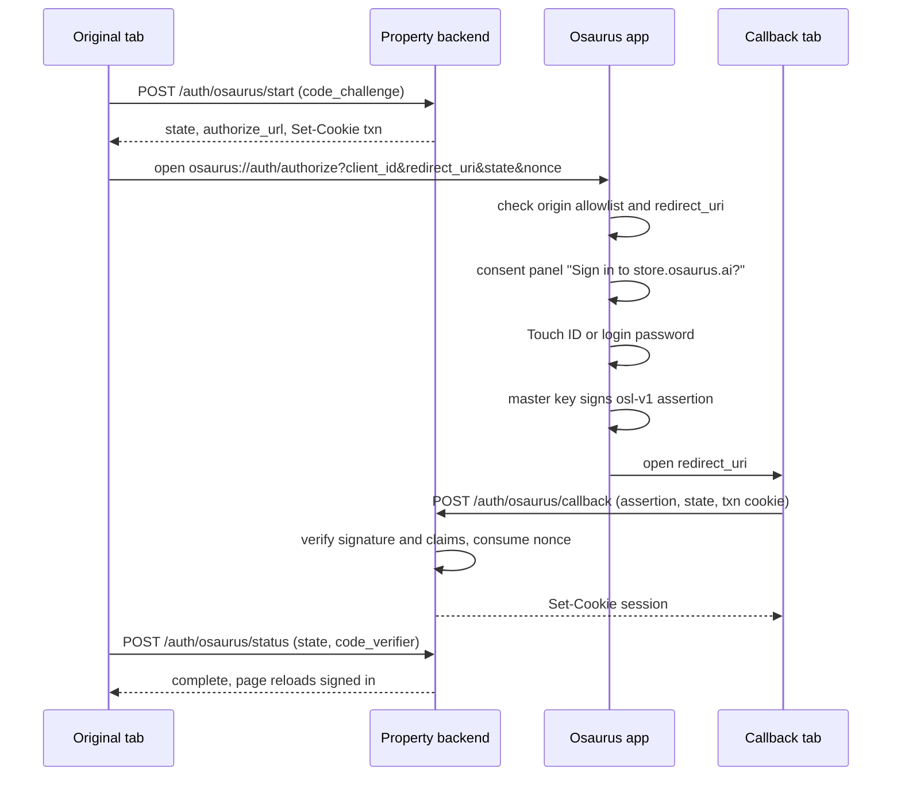

# Log in with Osaurus

"Log in with Osaurus" lets an Osaurus website (store.osaurus.ai today, any first-party property tomorrow) sign a user in with the identity they already have in the Osaurus Mac app. The site opens Osaurus, the user approves the request and confirms with Touch ID, and the app hands the browser a short-lived, single-use **login assertion** signed by the user's master key. The site verifies the signature itself and starts its own session.

There is no Osaurus login server in the loop. Every property verifies assertions locally with any Ethereum signature library (viem, ethers, web3.py, go-ethereum), because the assertion is a plain EIP-191 `personal_sign` signature by the user's master address: the same key and scheme the store registry already verifies for publishing.

- Protocol version: `osl-v1`
- App side: `Packages/OsaurusCore/Services/Auth/LoginWithOsaurus/`
- Reference relying party: [`docs/examples/login-with-osaurus/`](examples/login-with-osaurus/)

## Contents

- [How it works](#how-it-works)
- [Integrating a property](#integrating-a-property)
- [Protocol reference](#protocol-reference)
- [Verifying an assertion](#verifying-an-assertion)
- [Error codes](#error-codes)
- [Security model](#security-model)
- [Adding a new property](#adding-a-new-property)
- [Local development](#local-development)
- [Test vector](#test-vector)
- [Out of scope for v1](#out-of-scope-for-v1)

## How it works



1. The user clicks **Log in with Osaurus**. The page asks its backend to start a login. The backend creates a transaction (`state`, `nonce`, the page's PKCE `code_challenge`, 5-minute expiry) and sets a transaction cookie in this browser.
2. The page navigates to `osaurus://auth/authorize?...`. The browser hands the link to Osaurus; the page stays where it is.
3. Osaurus refuses anything not on its first-party origin allowlist, then shows a consent panel naming the exact origin and what the site receives (address, and Osaurus ID if claimed).
4. On **Continue**, macOS asks for Touch ID (or the login password on Macs without it). Osaurus reads the master key under that authentication, signs the assertion, and wipes the key from memory.
5. Osaurus opens `redirect_uri` in the default browser with the assertion in the URL fragment. The callback page posts it to the backend, which verifies it, consumes the nonce, and sets the session cookie.
6. The original tab is in the same browser, so it already shares the session cookie. It learns the login finished from a `BroadcastChannel` message and by polling `/status` with its `code_verifier`, then reloads.

## Integrating a property

You need two pages and three endpoints. [`verify.ts`](examples/login-with-osaurus/verify.ts) implements the endpoints' logic, [`client.js`](examples/login-with-osaurus/client.js) the browser side, and [`server.ts`](examples/login-with-osaurus/server.ts) wires them into a complete runnable example.

| Piece | What it does |
|-------|--------------|
| Button page | Calls `startOsaurusLogin()`; reloads when it resolves. |
| `GET <redirect_uri>` | Static page that calls `handleOsaurusCallback()`. |
| `POST /auth/osaurus/start` | `rp.start({ codeChallenge })`; set the `transactionId` cookie; return `{ state, authorize_url }`. |
| `POST /auth/osaurus/callback` | `rp.callback({ assertion, state, transactionId })`; on success create your session for `claims.iss`. |
| `POST /auth/osaurus/status` | `rp.status({ state, codeVerifier, transactionId })`; tells the original tab when to reload. |

```ts
import { OsaurusLoginRelyingParty } from "./verify";

const rp = new OsaurusLoginRelyingParty({
  origin: "https://store.osaurus.ai",
  redirectUri: "https://store.osaurus.ai/auth/osaurus/callback",
  store: new RedisLoginTransactionStore(), // anything with an atomic pending -> complete update
});

// POST /auth/osaurus/callback
const claims = await rp.callback({ assertion, state, transactionId: req.cookies["__Host-osl_txn"] });
await createSession(res, { accountId: claims.iss, osaurusIdHint: claims.osaurus_id });
```

Requirements for every property:

- Serve the button page, callback page, and endpoints from the **same origin** you send as `client_id`. `redirect_uri` must be on that origin.
- The transaction cookie is `HttpOnly; Secure; SameSite=Lax` (`__Host-` prefix recommended), lives no longer than the transaction (5 minutes), and is cleared on success.
- The three endpoints accept same-origin `POST` only (check the `Origin` header). Responses are `Cache-Control: no-store`.
- The callback page sends `Referrer-Policy: no-referrer` and removes the fragment from history before doing anything else (`client.js` does).
- Key accounts on `iss`, the lowercase master address. It is stable for the person across every Osaurus property and every one of their Macs.
- Treat `osaurus_id` as a display hint. It is what the user's Mac last saw, not proof of the handle; never authorize on it.
- Issue your own session with your own lifetime. The assertion is a one-time proof, not a bearer token: do not store it or forward it to other services.

### When Osaurus isn't installed

Browsers give no signal when a custom-scheme link goes unhandled. `startOsaurusLogin({ onNotInstalled })` fires the callback if the page never lost focus 2.5 seconds after opening the link; show a download link then. Keep the login pending: a user who installs and opens Osaurus within the transaction lifetime can click the button again.

### Callback in a different browser

Osaurus opens `redirect_uri` in the **default** browser. If the user started in another browser, the callback has no transaction cookie and `callback` fails with `browser_mismatch` without consuming the nonce. `handleOsaurusCallback` exposes `continueURL`; show it so the user can paste it into the browser they started in, where it completes normally until the assertion expires. Tell users to paste it only into another browser on the same Mac and never to send it to anyone (see [Security model](#security-model)).

## Protocol reference

### Authorization request

The page opens:

```
osaurus://auth/authorize?client_id=<origin>&redirect_uri=<url>&state=<opaque>&nonce=<opaque>[&response_mode=fragment|query]
```

| Parameter | Required | Rules |
|-----------|----------|-------|
| `client_id` | yes | A bare origin: `https://host[:port]`, no path (a trailing `/` is tolerated), query, fragment, or credentials. Compared after lowercasing and dropping the default port. Must be on the app's allowlist. |
| `redirect_uri` | yes | Absolute URL on exactly the `client_id` origin (scheme, host, port). May have a query; must not have a fragment or credentials. At most 2048 characters. |
| `state` | yes | 1-512 characters from `A-Z a-z 0-9 - . _ ~`. Echoed back unchanged. Bind it to the transaction. |
| `nonce` | yes | 16-128 characters from `A-Z a-z 0-9 - . _ ~`. Signed into the assertion. Use at least 128 bits of randomness and accept it once. |
| `response_mode` | no | `fragment` (default, recommended) or `query`. |

Any parameter given twice makes the request invalid. Unknown parameters are ignored.

### Response

Osaurus opens `redirect_uri` with parameters appended to the fragment (or to the existing query in `query` mode), form-encoded:

| Outcome | Parameters |
|---------|------------|
| Success | `assertion`, `state` |
| Error | `error`, `error_description` (developer-facing English, may change), `state` (omitted only when the request's own `state` was invalid) |

Example:

```
https://store.osaurus.ai/auth/osaurus/callback#assertion=osl-v1.eyJ...X0.0x88f3...1c&state=st_8f2b1c
```

When `client_id` is not allowed or `redirect_uri` is invalid, nothing is opened: the user sees an error in Osaurus and the page simply never hears back.

### Assertion format

```
osl-v1.<payload>.<signature>
```

- `payload` is base64url (no padding) of a UTF-8 JSON object. Osaurus emits sorted keys, but verifiers must not depend on key order or re-encode: always verify against the payload string exactly as received.
- `signature` is `0x` + 130 hex characters: the 65-byte `r || s || v` secp256k1 signature, `v` in {27, 28}.
- The signed message is the UTF-8 string `osaurus-login-v1.` followed by the `payload` string, signed with EIP-191 `personal_sign`, i.e. secp256k1 over `keccak256("\x19Ethereum Signed Message:\n" + len(message) + message)`. The recovered address is the signer.

| Claim | Type | Meaning |
|-------|------|---------|
| `typ` | string | Always `osaurus-login`. |
| `ver` | number | Always `1`. |
| `iss` | string | Lowercase master address (`0x` + 40 hex). The user. |
| `aud` | string | The canonical `client_id` origin the assertion is for. |
| `redirect_uri` | string | The `redirect_uri` the request carried. |
| `nonce` | string | The request's `nonce`. |
| `iat` | number | Signing time, Unix seconds. |
| `exp` | number | `iat + 300`. |
| `jti` | string | Unique id for this assertion. Log it. |
| `osaurus_id` | string, optional | Claimed Osaurus ID without `@`, if the Mac knows one. Display hint only. |
| `dev` | string, optional | Osaurus device id of the signing Mac (8 hex). Useful for "signed in from" displays. |

The `osaurus-login-v1.` prefix keeps login signatures disjoint from every other message Osaurus signs with the master key (`osaurus-workflow:…`, `osaurus-credits:…`, `osaurus-owner:redeem:…`), so a login can't be replayed as any of them, or vice versa.

## Verifying an assertion

A relying party **must**, in this order:

1. Split on `.` into exactly three parts; the first is `osl-v1`; the payload is base64url; the signature matches `^0x[0-9a-fA-F]{130}$`.
2. Decode the payload JSON and read `iss`.
3. Verify the EIP-191 signature of `osaurus-login-v1.<payload as received>` recovers `iss` (case-insensitive).
4. Check `typ == "osaurus-login"` and `ver == 1`.
5. Check `aud` equals its own origin exactly, and `redirect_uri` equals its registered callback exactly.
6. Look up the transaction by `state`; check it is pending, unexpired, and belongs to this browser (transaction cookie); check `nonce` equals the transaction's nonce.
7. Check `exp - iat <= 300`, `iat <= now + 60`, and `exp > now - 60` (60 seconds of clock skew).
8. Atomically mark the transaction complete. If it was already complete, reject: that is a replay.

Only then create the session. With viem, step 3 is:

```ts
const ok = await verifyMessage({ address: claims.iss, message: "osaurus-login-v1." + payload, signature });
```

## Error codes

| `error` | When | Suggested UI |
|---------|------|--------------|
| `access_denied` | The user chose Cancel, closed the panel, ignored it for 2 minutes, or cancelled/failed Touch ID. | "Sign-in cancelled." Offer to retry. |
| `login_required` | This Mac has no Osaurus identity. Osaurus opens its Identity settings. | "Set up your identity in Osaurus, then try again." |
| `temporarily_unavailable` | Another sign-in is already waiting for the user. | "Finish the other sign-in in Osaurus first." |
| `invalid_request` | `state`, `nonce`, or `response_mode` failed validation. A bug in the property. | Generic error; log `error_description`. |
| `server_error` | Osaurus could not read the key or sign. | "Something went wrong in Osaurus." |

`unauthorized_client` exists in the app's vocabulary but is never sent: an unknown origin gets no redirect at all.

Reference relying-party errors (`OsaurusLoginError.code` in `verify.ts`): `malformed`, `bad_signature`, `wrong_type`, `audience_mismatch`, `redirect_uri_mismatch`, `nonce_mismatch`, `lifetime_too_long`, `issued_in_future`, `expired`, `unknown_state`, `browser_mismatch` (HTTP 409), `already_used`.

## Security model

What a verified assertion proves: the person holding the master key behind `iss` approved, moments ago, signing in to exactly this origin, for exactly this login attempt, after unlocking with Touch ID or their password on one of their Macs.

What makes that hold:

- **User presence.** Every login needs an explicit `LAContext.evaluatePolicy` check with a fresh context and no reuse window, after the consent panel. An unlocked Mac or a recent unlock never approves a login by itself.
- **Audience binding.** `aud` and `redirect_uri` are signed. An assertion for one property is worthless at every other property, including other Osaurus properties.
- **Origin allowlist.** Only built-in first-party origins can trigger the consent panel. `redirect_uri` must sit on the `client_id` origin, so the browser only ever delivers the assertion to the site named in the panel.
- **One-time use.** The nonce is single-use and the assertion lives 5 minutes.
- **Browser binding.** The transaction cookie ties the callback to the browser that started the login, and the `code_verifier` ties `/status` to the tab that started it.
- **Key handling.** The master key is read only after consent and Touch ID, used once, and zeroed. It never leaves the Mac; websites never see anything that could sign again.
- **Panel integrity.** The panel names the site only from the validated `client_id`; no other request field is displayed. Keyboard shortcuts work only while the panel is focused (a keystroke aimed at another app can't approve), and only one panel can be open.

| Threat | Mitigation |
|--------|-----------|
| Phishing site requests a login | Not on the allowlist: refused before any prompt. |
| Allowed site asks to deliver to an attacker URL | `redirect_uri` must be on the `client_id` origin. |
| Assertion leaked (history, logs, extension) | Fragment delivery keeps it out of server logs and Referer; callback strips it from history; it is single-use, 5-minute, and audience-bound. |
| Replay of a captured assertion | Nonce consumed atomically on first use. |
| Attacker starts a login and gets the victim to approve it | The callback lands in the victim's browser without the attacker's transaction cookie (`browser_mismatch`), so no session is created for anyone. The attacker's own tab can't complete without the callback succeeding. See the residual risk below. |
| Attacker forces their own login into the victim's browser | The callback needs the transaction cookie set by `/start` in that browser. |
| Clock tampering on the Mac | Verifiers use their own clock with 60 seconds of skew and cap lifetime at 300 seconds. |
| Malicious local app opens `osaurus://auth/authorize` | It can only show the panel for an allowlisted site, still needs Touch ID, and the result goes to that site in the browser, not to the local app. |
| Signature confusion with other Osaurus signatures | The `osaurus-login-v1.` message prefix is unique to logins. |

Residual risks properties should know about:

- Anyone who can unlock the Mac with Touch ID or the password can sign in as its owner. That is the same trust boundary as the rest of the Osaurus identity.
- The `browser_mismatch` link carries a live assertion. A victim who is talked into approving an attacker's login *and* sending that link back would hand over a session. Word the message as "copy this into another browser on this Mac; never send it to anyone", or drop the different-browser fallback entirely if your users don't need it.
- Because accounts key on the master address, a user who resets their identity (new master key) appears as a new account. Restoring from the recovery phrase keeps the same address.

## Adding a new property

1. Add the origin to `LoginWithOsaurusClients.firstPartyOrigins` in `Packages/OsaurusCore/Services/Auth/LoginWithOsaurus/LoginWithOsaurusRequest.swift` and update `firstPartyListIsExact` in `Tests/Auth/LoginWithOsaurusRequestTests.swift`.
2. Ship an Osaurus release. Until users update, the property gets no response (the app refuses unknown origins silently), so gate the button on the minimum app version if you can detect it, or explain "Requires Osaurus <version> or later" near the button.
3. Implement the endpoints, run `check-vector.ts` against your verifier, and test cancel, expiry, replay, and the different-browser case.

Current allowlist: `https://store.osaurus.ai`, `https://osaurus.ai`, `https://www.osaurus.ai`.

## Local development

Release builds accept only the allowlist above. DEBUG builds of Osaurus also read extra origins, including plain-http loopback origins, from a user default:

```bash
defaults write com.dinoki.osaurus ai.osaurus.loginWithOsaurus.extraClientOrigins -array "http://localhost:8787"
```

Then run the example property:

```bash
cd docs/examples/login-with-osaurus
npm install
ORIGIN=http://localhost:8787 npm start
npm run check-vector   # verifier conformance against vector.json
```

Open http://localhost:8787 in your default browser and click **Log in with Osaurus**. Remove the override with `defaults delete com.dinoki.osaurus ai.osaurus.loginWithOsaurus.extraClientOrigins`.

## Test vector

[`vector.json`](examples/login-with-osaurus/vector.json) holds a complete vector: the inputs, the payload, and the assertion. The key is Hardhat/Anvil test account #0 (public; never use it for anything real). Signing is RFC 6979 deterministic, so any conforming signer produces the identical assertion. It is pinned in `Tests/Auth/LoginAssertionTests.swift` (`publishedVectorIsStable`), and `check-vector.ts` confirms viem reproduces the signature byte for byte.

| Input | Value |
|-------|-------|
| Address | `0xf39fd6e51aad88f6f4ce6ab8827279cfffb92266` |
| `client_id` / `aud` | `https://store.osaurus.ai` |
| `redirect_uri` | `https://store.osaurus.ai/auth/osaurus/callback` |
| `nonce` | `n0nce-0123456789abcdef` |
| `iat` / `exp` | `1791600000` / `1791600300` |
| `jti` | `00000000-0000-4000-8000-000000000001` |
| `osaurus_id` / `dev` | `alice` / `a1b2c3d4` |

Verifying it at `now = 1791600010` succeeds; at `exp + 61` it fails as expired; with any other audience, redirect, or nonce it fails on that claim.

## Out of scope for v1

- **Third-party sites.** v1 is first-party only. Opening it up needs a client registry and a stronger consent design.
- **OAuth 2.0 / OpenID Connect.** The request parameters are OAuth-shaped (`client_id`, `redirect_uri`, `state`, `nonce`, OAuth error codes) so a central authorization server can later wrap this flow and issue standard ID tokens, without changing the app's consent and signing steps.
- **Silent re-authentication.** Every login shows the panel and asks for Touch ID. Properties keep users signed in with their own sessions.
- **Delegated API access.** An assertion grants nothing inside Osaurus itself. Access to a user's Osaurus server still uses `osk-v1` access keys (see [IDENTITY.md](IDENTITY.md#access-keys-osk-v1)).
